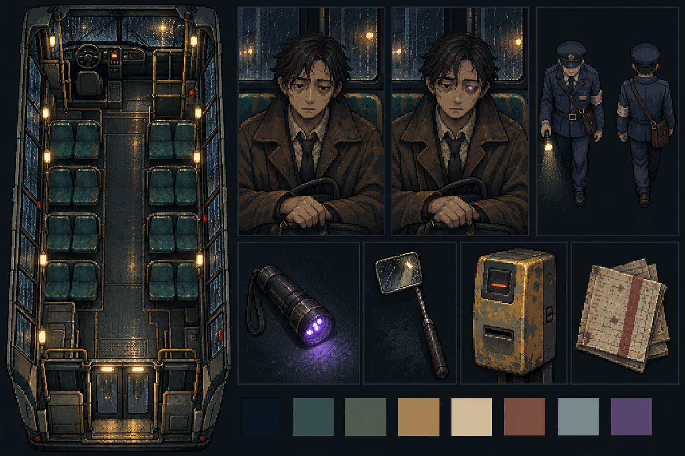

# Định hướng asset — Chuyến Xe Cuối

Ngày: 29/10/2026. Phong cách người dùng chọn: pixel art 2D vẽ tay tối tăm.

**Trạng thái:** Người dùng đã duyệt phong cách bảng mẫu v01. Bộ thiết kế mở rộng được lưu trong [Expansion-v01](Expansion-v01/README.md); các mẫu mở rộng chưa phải asset runtime hoàn chỉnh.

**Mở rộng v02:** [Thế giới, hành khách, đạo cụ, thiết bị, UI và dị thường](Expansion-v02/README.md) — 6 bảng concept mới, kèm prompt và kiểm tra file.

## Mẫu định hướng v01

Ảnh tạo bằng công cụ ImageGen tích hợp. Đây là concept để thống nhất cảm giác, chất liệu và màu sắc; chưa phải sprite sheet, tilemap hoặc asset sẵn sàng nhập game. Bố trí ghế và góc nhìn trong ảnh không thay thế thông số GDD.

## Ngôn ngữ hình ảnh

- Pixel rõ, tạo khối bằng cụm màu có chủ đích, nét viền bất quy tắc mang cảm giác vẽ tay.
- Không làm mượt đường biên hoặc thêm bộ lọc pixel lên ảnh hiện thực.
- Xe bus cũ: sơn tróc, vải ghế xanh bạc màu, kim loại xước, kính ướt mưa.
- Nguồn sáng vàng nhỏ, nền xanh xám lạnh. Giữ lối đi, mặt và tay đủ rõ để tương tác.
- Nhân vật có tỷ lệ trưởng thành, nét mệt mỏi, trang phục đời thường; tránh chibi.
- Dị thường là chi tiết có chủ đích. Không để hiệu ứng nhiễu che bằng chứng bắt buộc.
- Chân dung cũng dùng pixel art; có thể có mật độ chi tiết cao hơn sprite di chuyển.

## Bảng màu mục tiêu

Các mã sau là màu chỉ dẫn của prompt, không khẳng định ảnh sinh ra chỉ chứa đúng tám màu này.

| Vai trò | Màu |
|---|---|
| Nền gần đen | `#10191F` |
| Ghế, vách xanh cũ | `#30494A` |
| Xám rêu | `#596354` |
| Vàng đèn cũ | `#B39457` |
| Giấy và điểm sáng | `#D2C6A5` |
| Đỏ gạch trầm | `#774840` |
| Xám lạnh | `#829396` |
| UV, dùng tiết chế | `#74658A` |

## Thông số sản xuất đề xuất

Các kích thước dưới đây cần kiểm chứng bằng một bộ mẫu trước khi sản xuất hàng loạt.

- Grid môi trường: 32 × 32 px mỗi tile; props lớn dùng bội số grid.
- Sprite nhân vật: canvas 64 × 96 px, pivot tại bàn chân; bốn hướng dùng cùng tỷ lệ và điểm neo.
- Chân dung kiểm tra: 320 × 384 px, tách thân, mặt, mắt, tay và lớp dị thường.
- Icon công cụ: 64 × 64 px; hình công cụ lớn trong giao diện tạo riêng theo vùng tương tác.
- PNG sRGB; asset rời có alpha thật; concept giữ nền.
- Unity: Point filtering, không mipmap, không nén mất chi tiết; kiểm tra ở tỷ lệ phóng nguyên.
- Giữ master và bản export riêng. Không cắt bảng concept này rồi coi là bộ asset hoàn chỉnh.

## Thứ tự thiết kế tiếp theo

1. Nội thất xe trống: đúng 12 ghế, cabin, hai cửa, lối đi và điểm tương tác; góc nhìn top-down thống nhất.
2. Bộ ghế/sàn/cửa/cửa sổ tách lớp; ánh sáng và bóng riêng khi cần thay đổi trong gameplay.
3. Nhân viên soát vé: chốt một mẫu đứng trước khi làm bốn hướng và bước đi.
4. Một hành khách: sprite top-down và chân dung cùng trang phục, màu tóc, đặc điểm nhận dạng.
5. Dụng cụ UV, gương, đầu đọc vé và sổ tay ở cùng mức độ hao mòn.
6. Biến thể dị thường của hành khách mẫu; giữ mọi chi tiết khác nhất quán để kiểm chứng cơ chế quan sát.

## Kiểm tra trước khi nhập game

- Silhouette đọc được trên sàn tối và ghế xanh.
- Tỷ lệ nhân vật phù hợp chiều rộng lối đi, ghế và cửa.
- Bốn hướng giữ đúng kích thước, pivot và nguồn sáng.
- Chân dung người thật và thực thể chỉ khác ở chi tiết thiết kế có chủ đích.
- Asset xuất cuối không có viền nền thừa, chữ giả, bóng bị cắt hoặc chi tiết lẫn sang ô kế bên.
- Concept v01 còn có góc nhìn nhân vật gần chính diện và số ghế không khớp GDD; cần sửa ở asset riêng, chưa dùng làm bản đồ.

## Nguồn và prompt

- Công cụ: ImageGen tích hợp, không dùng CLI/API fallback.
- Prompt đầy đủ: [Concepts/style-board-v01-prompt.md](Concepts/style-board-v01-prompt.md).
