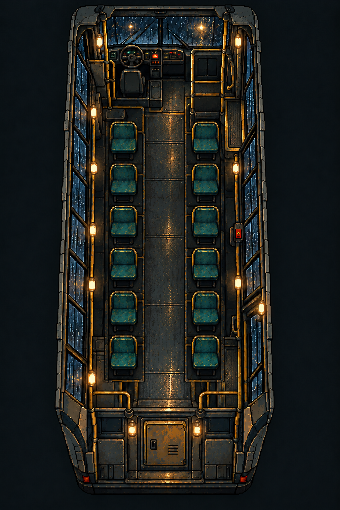
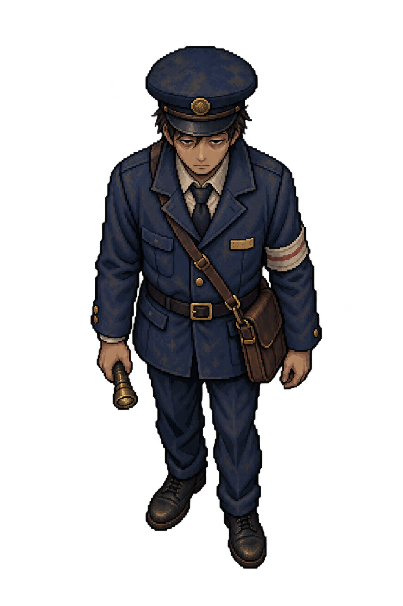
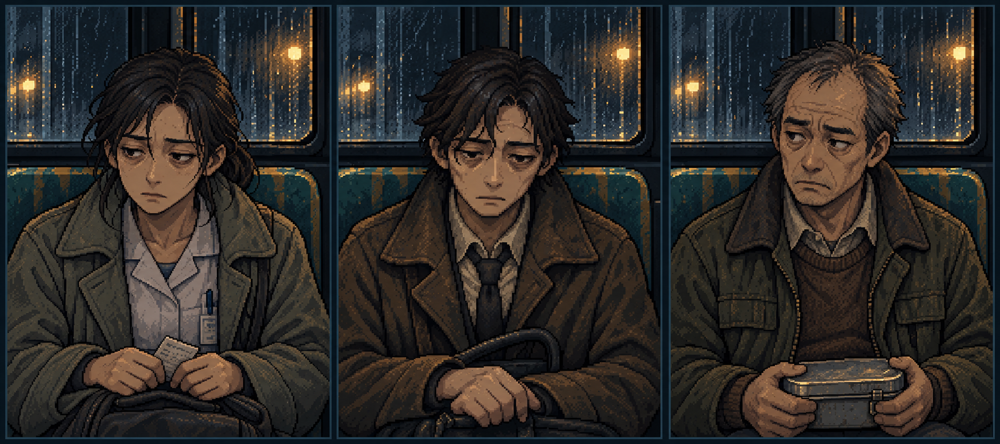
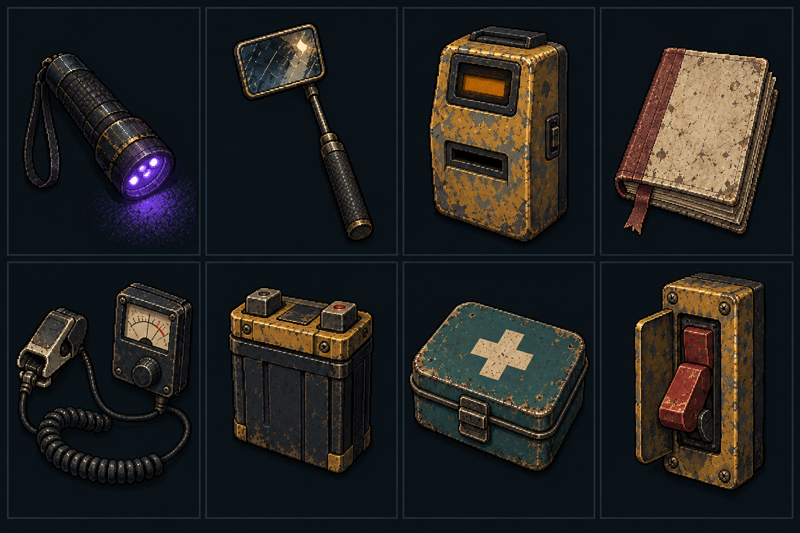

# Bộ thiết kế mở rộng v01 — Chuyến Xe Cuối

Ngày: 29/10/2026. Phong cách gốc đã được người dùng duyệt: pixel art 2D vẽ tay tối tăm. Các ảnh mở rộng dưới đây mới là thiết kế đề xuất, chưa mặc định đã được duyệt riêng.

Tạo bằng ImageGen tích hợp (`art_source: host_image`), tham chiếu trực tiếp [bảng mẫu đã duyệt](../Concepts/dark-pixel-style-board-v01.png). Prompt gốc và các lần chỉnh nằm trong `Prompts/`.

## 1. Nội thất xe — mẫu chính v03

- Kích thước: 1024 × 1536, nền đục.
- Đã kiểm tra bằng mắt: 6 hàng × 2 ghế đơn = 12 ghế hành khách; ghế tài xế tách riêng.
- Có cabin, lối đi trung tâm, cửa trước/cửa sau, đèn vàng, công tắc đỏ và tủ điện cuối xe.
- Giữ bố cục từ trên xuống có độ nghiêng minh họa; chưa phải bản tilemap vuông góc hoặc dữ liệu collision được kiểm chứng.
- Chưa tách nền, ghế, đèn và cửa. Cần chuẩn hóa phối cảnh và thử tỷ lệ nhân vật trước khi dùng trong gameplay.
- Bản v01 có 8 ghế và v02 có 10 ghế được giữ trong `Drafts/` để truy xuất quá trình chỉnh; không dùng làm bản chính.

## 2. Nhân viên soát vé — master v01

- Kích thước: 1024 × 1536, PNG ARGB. Đã kiểm tra hai góc ảnh có alpha bằng 0; chưa kiểm chứng toàn bộ viền alpha ở kích thước runtime.
- Đồng phục xanh hải quân cũ, mũ mềm, chi tiết đồng, túi vé bên hông trái và đèn pin tay phải.
- Một tư thế đứng, góc nhìn từ trên chếch xuống. Đây là master nhận diện, chưa phải sprite 64 × 96 hoặc bộ bốn hướng.
- Tiếp theo: đơn giản hóa chi tiết khi thu nhỏ, chốt góc nhìn khớp xe, kiểm tra silhouette, làm các hướng và hoạt ảnh riêng.

## 3. Ba hành khách — casting v01

Kích thước: 1881 × 836, bảng concept có nền, không phải atlas chia ô chuẩn.

| Vị trí | Thiết kế | Đặc điểm giữ nhất quán |
|---|---|---|
| Trái | Nhân viên y tế ca đêm | Áo xám xanh, sơ mi sáng, tóc buộc, vé giấy |
| Giữa | Người đi làm trẻ tuổi | Tóc nâu rối, áo khoác nâu, cà vạt tối, túi đen |
| Phải | Công nhân lớn tuổi | Tóc điểm bạc, áo lao động xanh rêu, hộp cơm kim loại |

Tất cả là người bình thường ở bản thiết kế này. Không dùng vẻ mệt mỏi, lo lắng hoặc tuổi tác làm bằng chứng thực thể. Chưa có phiên bản dị thường hoặc bộ lớp mắt/tay độc lập.

## 4. Tám dụng cụ — concept v01

Kích thước: 1536 × 1024, bảng 4 cột × 2 hàng có nền. Thứ tự trái sang phải:

| Hàng | Các dụng cụ |
|---|---|
| Trên | Đèn UV; gương kiểm chứng; đầu đọc vé; sổ tay |
| Dưới | Cảm biến nhịp và đồng hồ; pin dự phòng; hộp sơ cứu; công tắc khẩn cấp |

Cần xuất riêng từng vật, tạo bản tắt/bật/lỗi và tách màn hình/kim đồng hồ. Gương concept có vết xước đậm; bản gameplay cần vùng phản chiếu sạch để bằng chứng không bị che. Kích thước vật thể trong từng ô chỉ phục vụ trình bày, không phải cùng tỷ lệ vật lý.

## Trạng thái kỹ thuật

- Đã lưu nguyên bản PNG vào dự án, không ghi đè mẫu đã duyệt.
- Đã mở/xem từng ảnh tạo ra và kiểm tra kích thước, pixel format, alpha ở hai góc.
- Đây là nguồn thiết kế độ phân giải cao có thẩm mỹ pixel; chưa bảo đảm mọi cụm pixel nằm trên cùng grid logic.
- Chưa giảm màu, chuẩn hóa pixel grid, tách lớp, tạo collider, atlas hoặc animation.
- Chưa thay thế các hình khối trong prototype Unity.

## Backlog asset tiếp theo

- [x] Xác nhận phong cách gốc cùng người dùng.
- [x] Mở rộng nội thất xe đủ 12 ghế hành khách.
- [x] Tạo master nhận diện nhân viên.
- [x] Tạo ba thiết kế chân dung hành khách.
- [x] Tạo bộ tám thiết kế dụng cụ.
- [ ] Tách nội thất thành sàn, ghế, cabin, cửa, cửa sổ, tủ điện và đèn.
- [ ] Chốt góc nhìn và tỷ lệ pixel logic chung cho xe/nhân vật.
- [ ] Xuất mẫu nhân vật nhỏ có pivot thống nhất, sau đó làm bốn hướng.
- [ ] Tạo chân dung riêng và lớp dị thường tương ứng, giữ nguyên nhận dạng.
- [ ] Xuất từng công cụ với alpha và trạng thái tương tác.
- [ ] Kiểm tra asset ở độ phân giải game trước khi nhập Unity.
