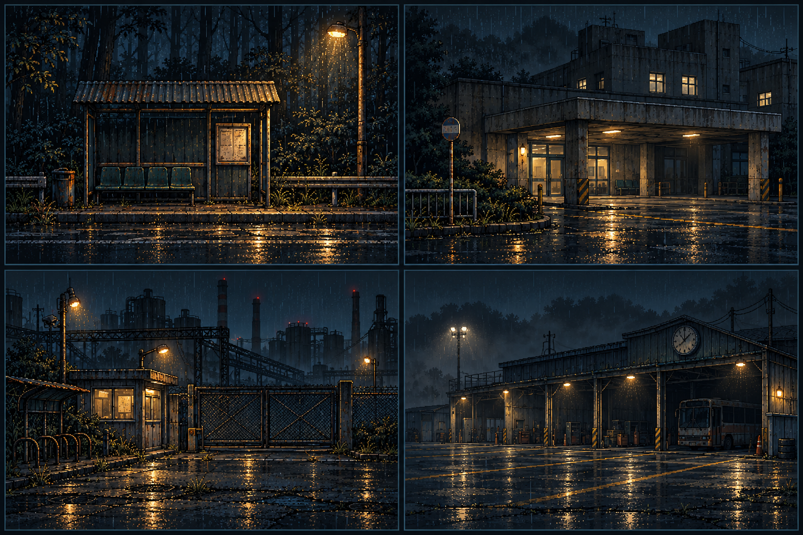
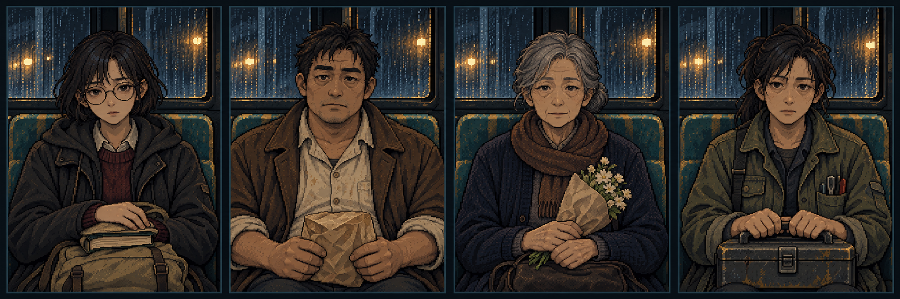
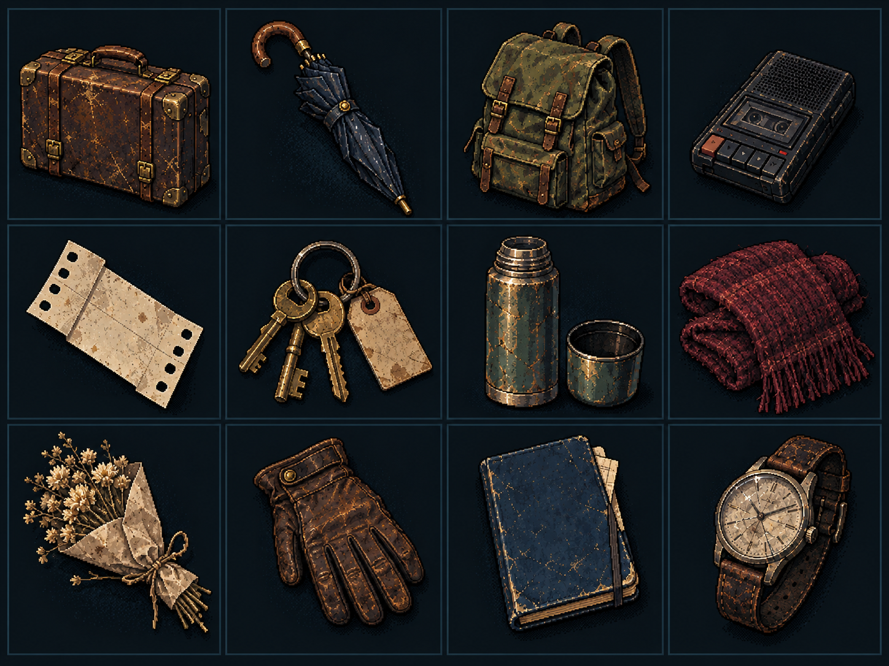
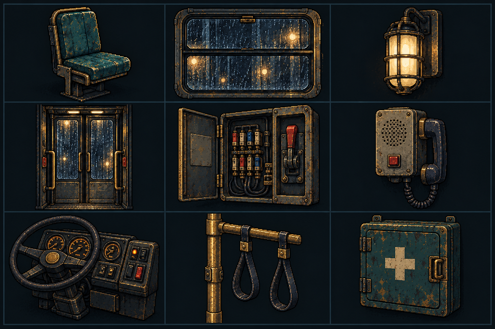
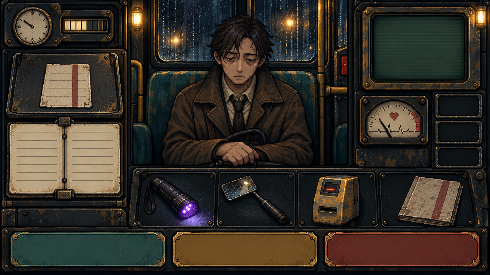
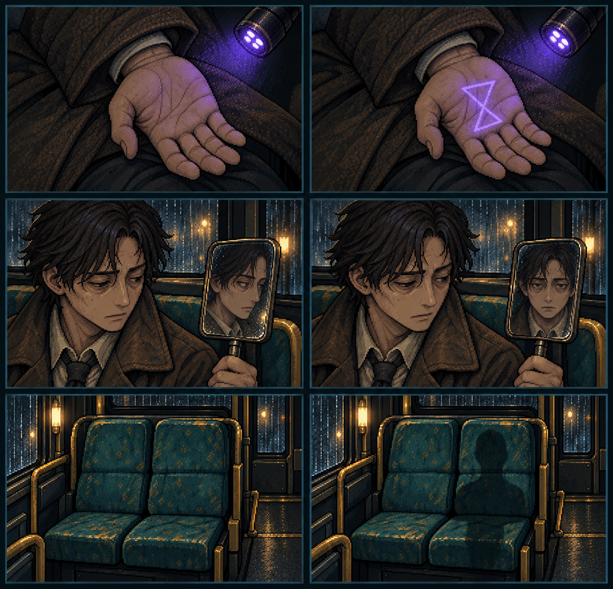

# Bộ thiết kế mở rộng v02 — Chuyến Xe Cuối

Ngày: 29/10/2026. Tiếp nối [bộ v01](../Expansion-v01/README.md), giữ phong cách pixel art vẽ tay tối tăm đã duyệt.

**6 bảng concept mới:** 4 địa điểm, 4 hành khách, 12 nhóm đồ thất lạc, 9 thiết bị nội thất, 1 mockup UI và 3 cặp dị thường. Chưa phải các sprite/atlas dùng trực tiếp trong Unity.

Tạo bằng ImageGen tích hợp (`art_source: host_image`), tham chiếu bảng mẫu đã duyệt. Prompt đầy đủ nằm trong `Prompts/`. Kích thước, pixel format và SHA-256 nằm trong [image-checks.json](image-checks.json).

## Ngoại cảnh tuyến xe

Ảnh 1536 × 1024. Từ trên trái theo từng hàng: trạm rừng, bệnh viện, cổng nhà máy và bến cuối. Dùng làm mẫu cảnh nhìn qua cửa xe; chưa mở rộng phạm vi sang khám phá ngoài xe. Khi sản xuất cần tách tiền cảnh, công trình, trời, mưa và đèn; ảnh hiện tại chưa có lớp parallax.

## Bốn hành khách mới

Ảnh 2172 × 724. Trái sang phải: sinh viên trưởng thành với kính và sách; đầu bếp tan ca mang gói đồ ăn; người phụ nữ lớn tuổi cầm hoa; thợ điện nữ cầm hộp dụng cụ.

Cộng với v01 hiện có **7 mẫu hành khách**. Nghề nghiệp mới là ý tưởng tạo hình, chưa phải lời thoại chính thức. Tuổi tác, kính mắt và vẻ mệt mỏi không phải bằng chứng thực thể.

## Mười hai nhóm đồ thất lạc

Ảnh 1448 × 1086. Thứ tự trái sang phải:

| Hàng | Đồ vật |
|---|---|
| 1 | Vali da; ô gấp; ba lô; máy cassette |
| 2 | Vé giấy; chùm chìa khóa; bình giữ nhiệt và nắp; khăn len |
| 3 | Hoa khô; găng tay; nhật ký; đồng hồ nứt kính |

Ứng dụng đề xuất: tìm đồ, đối chiếu vật mang theo, vật chứng cốt truyện và trang trí ghế. Chưa thêm cơ chế vào gameplay. Vé trong ảnh chỉ là mẫu chất liệu; mã vé, chữ và dấu xác thực cần được dựng bằng dữ liệu kiểm soát được.

## Chín cấu kiện nội thất

Ảnh 1536 × 1024. Thứ tự trái sang phải:

| Hàng | Thiết bị |
|---|---|
| 1 | Ghế đơn; cửa sổ mưa; đèn tường |
| 2 | Cửa gấp; tủ cầu chì; intercom |
| 3 | Vô-lăng và bảng đồng hồ; thanh vịn/quai nắm; tủ sơ cứu |

Góc nhìn là nghiên cứu vật thể, chưa khớp camera top-down. Cần xuất riêng và làm các trạng thái cửa mở/đóng, đèn bật/tắt, cầu chì tốt/hỏng. Chưa có các trạng thái đó trong ảnh.

## Giao diện kiểm tra

Ảnh 1672 × 941. Bên trái là đồng hồ, pin, khay vé và sổ; giữa là hành khách; bên phải là thiết bị và ô bằng chứng; phía dưới là công cụ và ba vùng quyết định.

Đây là mockup hình ảnh, chưa có layout responsive hoặc logic nút. Chữ sẽ dùng UI thật để đọc, dịch và thay đổi trạng thái. Tay hành khách đang chồng nhau nên cần pose riêng khi kiểm tra lòng bàn tay. Vài nét/số trên đồng hồ cần thay bằng mặt đồng hồ được kiểm soát. Các nút phải có nhãn và biểu tượng, không chỉ phân biệt bằng màu.

## Ba cặp dị thường

Ảnh 1278 × 1230; trái bình thường, phải bất thường:

| Hàng | Khác biệt chính | Ý nghĩa |
|---|---|---|
| Trên | Dấu tam giác kép trên lòng bàn tay dưới UV | Hướng thiết kế Kẻ Mang Dấu |
| Giữa | Người quay mặt nhưng phản chiếu nhìn thẳng | Hướng thiết kế Kẻ Phản Chiếu |
| Dưới | Ghế trống có bóng người | Sự kiện môi trường đề xuất, chưa phải quy tắc phân loại |

Ảnh sinh có khác biệt ngoài dấu hiệu chính ở tay, ánh sáng và khung gương. Không dùng trực tiếp làm câu đố tìm điểm khác biệt. Bản sản xuất cần một nền gốc và lớp dị thường riêng. Ghế đôi trong minh họa này không thay thiết kế 12 ghế đơn của xe.

## Kiểm chứng và giới hạn

- Đã xem sáu ảnh và kiểm tra số nhóm/ô trong danh mục.
- Đã đọc PNG, xác nhận kích thước và tính hash.
- Cả sáu ảnh RGB nền đục, chưa tách alpha, layer hoặc atlas.
- Chưa chuẩn hóa grid pixel logic và bảng màu giới hạn.
- Chưa tạo hoạt ảnh, collision, parallax hoặc tích hợp Unity.
- Phong cách gốc đã duyệt; chi tiết các mẫu mở rộng vẫn là đề xuất.

## Thứ tự sản xuất đề xuất

1. Ghế, sàn, cửa và cửa sổ theo cùng camera; thử tỷ lệ với nhân viên.
2. Khung UI, chân dung gốc và pose bàn tay; giữ vùng chữ sạch.
3. Dấu UV và phản chiếu tách lớp từ cùng ảnh gốc.
4. Dụng cụ tắt/bật/lỗi và vùng tương tác.
5. Một trạm có lớp parallax để kiểm chứng chuẩn ngoại cảnh.
6. Nhân rộng hành khách và đạo cụ khi bộ mẫu chạy tốt ở kích thước game.
